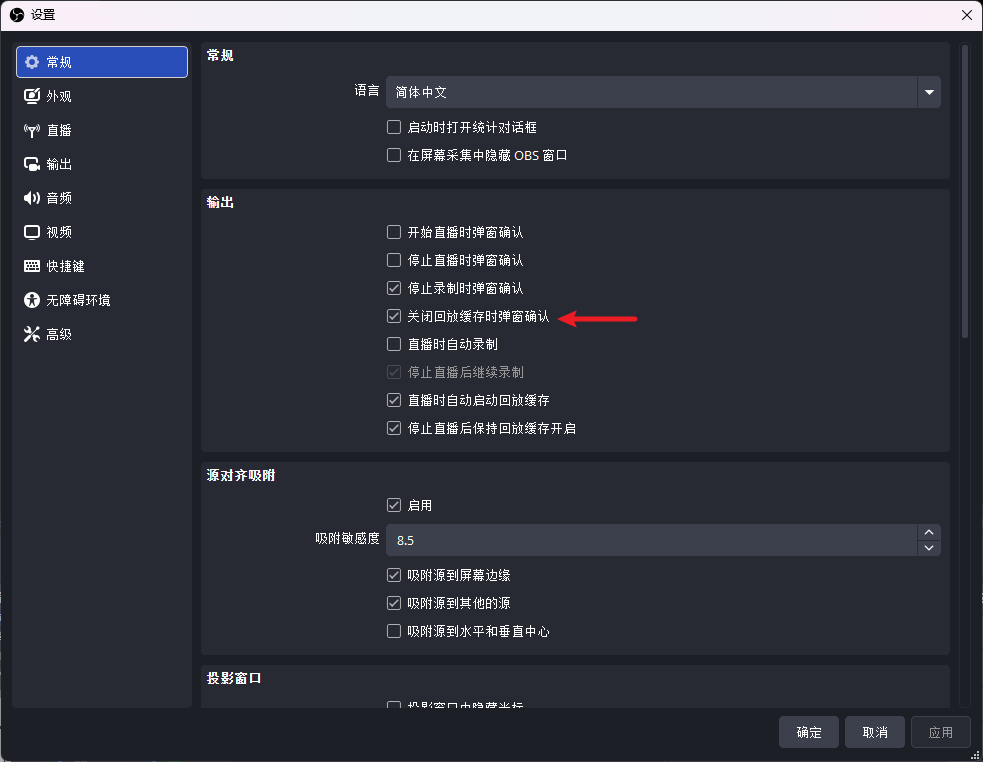
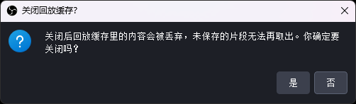

# obs-replay-buffer-confirm

**中文** | [English](README_en.md)

给 OBS 的关闭回放缓存加一个二次确认弹窗，防止出现没有保存回放文件时误触关闭回放缓存按键导致丢失录像的情况。

> 本插件由 AI 编写，代码里大概有屎山，介意的先看源码再决定装不装。

## 支持版本

OBS Studio 32.2.2，即 Steam 上对应的版本。头文件与接口都按 32.2.2 编译，33.x 未验证。

## 安装

下载 Release 里的 zip，解压到 `C:\ProgramData\obs-studio\plugins\`，目录结构应为：

```
plugins\obs-replay-buffer-confirm\bin\64bit\obs-replay-buffer-confirm.dll
plugins\obs-replay-buffer-confirm\data\locale\zh-CN.ini
```

重启 OBS 生效。便携模式下这个目录不参与加载。

## 使用

设置 → 常规 → 输出，勾选「关闭回放缓存时弹窗确认」，位置在「停止录制时弹窗确认」下方。



开启后点主界面的「关闭回放缓存」，或系统托盘里的同名项，会先弹确认框，默认停在「否」。
主窗口最小化到托盘时不弹窗，直接停止，和 OBS 的停止录制确认一致。



开关存在 `%AppData%\obs-studio\plugin_config\obs-replay-buffer-confirm\settings.json`。

## 目前不生效的情况

- 设置里的「关闭回放缓存」快捷键（`OBSBasic.StopReplayBuffer`）：由 OBS 自己注册，插件拿不到那个回调，因此使用快捷键无法触发二次确认弹窗
- 停止录制或停止推流带出的自动停止：这属于主操作的结果，不会再次弹窗打断，且已有设置选项可以调整这种情况

## 构建

需要 MSVC（VS 2022 及以上）、CMake 3.28 以上，以及三样依赖。依赖放 `.deps/`，不入库。

一、从 OBS 源码导出 32.2.2 的头文件：

```powershell
git -C <obs-studio 仓库> archive --format=zip 32.2.2 libobs frontend/api -o obs-sdk.zip
Expand-Archive obs-sdk.zip -DestinationPath .deps\obs-sdk
```

`libobs\obsconfig.h` 在源码里是 `@...@` 模板，要自己写一份最小版：

```c
#pragma once
#define OBS_RELEASE_CANDIDATE 0
#define OBS_BETA 0
```

二、用 OBS 安装目录里的 DLL 生成导入库（VS 开发者命令行里执行）：

```powershell
dumpbin /exports obs.dll > obs.def
lib /def:obs.def /machine:x64 /out:.deps\lib\obs.lib
dumpbin /exports obs-frontend-api.dll > obs-frontend-api.def
lib /def:obs-frontend-api.def /machine:x64 /out:.deps\lib\obs-frontend-api.lib
```

dumpbin 的输出要清成合法 `.def`，只留 `LIBRARY` 与 `EXPORTS` 两段和符号名。

三、Qt 6.11.1 开发包。版本必须和 OBS 自带的 Qt 一致，跨 minor 不保证二进制兼容：

```
https://github.com/obsproject/obs-deps/releases/download/<日期>/windows-deps-qt6-<日期>-x64.zip
```

解压到 `.deps\qt6`，包里带 `include`、`lib`、`bin`（含 `moc.exe`）。

四、构建。路径含中文时 moc 与 cl 会读错编码，先映射一个 ASCII 盘符：

```powershell
cmd /c subst X: "E:\DSH-Work\OBS插件"

$cmake = 'E:\Microsoft Visual Studio\18\Community\Common7\IDE\CommonExtensions\Microsoft\CMake\CMake\bin\cmake.exe'
& $cmake -S X:\Github\obs-replay-buffer-confirm -B X:\Github\obs-replay-buffer-confirm\build `
    -G "Visual Studio 18 2026" -A x64 `
    -DCMAKE_PREFIX_PATH=X:\Github\obs-replay-buffer-confirm\.deps\qt6
& $cmake --build X:\Github\obs-replay-buffer-confirm\build --config RelWithDebInfo
```

五、打包。产物在 `build\RelWithDebInfo\obs-replay-buffer-confirm.dll`：

```powershell
& $cmake --install X:\Github\obs-replay-buffer-confirm\build --config RelWithDebInfo `
    --prefix X:\Github\obs-replay-buffer-confirm\release
Compress-Archive -Path release\obs-replay-buffer-confirm `
    -DestinationPath release\obs-replay-buffer-confirm-0.1.0-windows-x64.zip
```

插件没有开 `AUTOMOC`。`ReplayBufferGuard` 只重写 `eventFilter`、只用函数指针 connect，
不需要元对象；这台机器上 moc 写不了文件，绕开以后构建少一个变量。要加自定义信号时得先解决它。

## 许可

GPL-3.0，见 `LICENSE`。