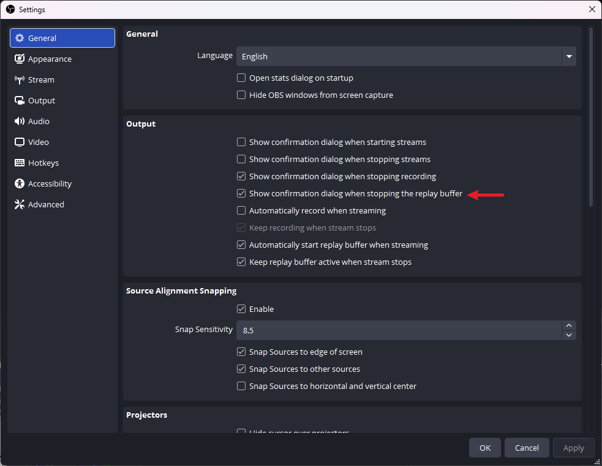
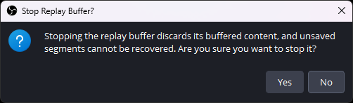

# obs-replay-buffer-confirm

[中文](README.md) | **English**

Adds a confirmation dialog when stopping the replay buffer in OBS, so a stray click cannot throw
away footage that was never saved.

> Written by AI. Expect slop code — read the source before you trust it.

## Requirements

OBS Studio 32.2.2, the version Steam ships. Headers and interfaces are built against 32.2.2;
33.x is untested.

## Installation

Grab the zip from Releases and extract it into `C:\ProgramData\obs-studio\plugins\`. The layout
should be:

```
plugins\obs-replay-buffer-confirm\bin\64bit\obs-replay-buffer-confirm.dll
plugins\obs-replay-buffer-confirm\data\locale\en-US.ini
```

Restart OBS. Portable mode ignores this directory.

## Usage

Settings → General → Output, tick "Show confirmation dialog when stopping the replay buffer",
right below "Show confirmation dialog when stopping recording".



Once enabled, clicking "Stop Replay Buffer" on the main window or the matching tray item asks
first, with "No" as the default button. When the main window is hidden to the tray, it stops
without asking, matching how OBS confirms recording.



The toggle lives in `%AppData%\obs-studio\plugin_config\obs-replay-buffer-confirm\settings.json`.

## Where it does not apply

- The "Stop Replay Buffer" hotkey in Settings (`OBSBasic.StopReplayBuffer`): OBS registers it
  internally and the callback is out of reach, so using that key does not bring up the dialog
- The automatic stop triggered by stopping recording or streaming: it comes from an action the user
  already confirmed, so it does not ask again, and OBS already has settings that cover that case

## Building

Requires MSVC (VS 2022 or newer), CMake 3.28 or newer, and three dependencies. They live in
`.deps/`, which is not tracked.

One, export the 32.2.2 headers from the OBS source tree:

```powershell
git -C <obs-studio checkout> archive --format=zip 32.2.2 libobs frontend/api -o obs-sdk.zip
Expand-Archive obs-sdk.zip -DestinationPath .deps\obs-sdk
```

`libobs\obsconfig.h` is a `@...@` template upstream, so write a minimal one by hand:

```c
#pragma once
#define OBS_RELEASE_CANDIDATE 0
#define OBS_BETA 0
```

Two, generate import libraries from the DLLs shipped with OBS (from a VS developer prompt):

```powershell
dumpbin /exports obs.dll > obs.def
lib /def:obs.def /machine:x64 /out:.deps\lib\obs.lib
dumpbin /exports obs-frontend-api.dll > obs-frontend-api.def
lib /def:obs-frontend-api.def /machine:x64 /out:.deps\lib\obs-frontend-api.lib
```

The dumpbin output has to be cleaned into a valid `.def`: just `LIBRARY`, `EXPORTS`, and the
symbol names.

Three, the Qt 6.11.1 development package. It must match the Qt OBS ships; binaries are not
compatible across minor versions:

```
https://github.com/obsproject/obs-deps/releases/download/<date>/windows-deps-qt6-<date>-x64.zip
```

Extract it to `.deps\qt6`; it carries `include`, `lib`, and `bin` (including `moc.exe`).

Four, build. moc and cl misread the encoding of non-ASCII paths, so map an ASCII drive first:

```powershell
cmd /c subst X: "E:\DSH-Work\OBS插件"

$cmake = 'E:\Microsoft Visual Studio\18\Community\Common7\IDE\CommonExtensions\Microsoft\CMake\CMake\bin\cmake.exe'
& $cmake -S X:\Github\obs-replay-buffer-confirm -B X:\Github\obs-replay-buffer-confirm\build `
    -G "Visual Studio 18 2026" -A x64 `
    -DCMAKE_PREFIX_PATH=X:\Github\obs-replay-buffer-confirm\.deps\qt6
& $cmake --build X:\Github\obs-replay-buffer-confirm\build --config RelWithDebInfo
```

Five, package. The output is `build\RelWithDebInfo\obs-replay-buffer-confirm.dll`:

```powershell
& $cmake --install X:\Github\obs-replay-buffer-confirm\build --config RelWithDebInfo `
    --prefix X:\Github\obs-replay-buffer-confirm\release
Compress-Archive -Path release\obs-replay-buffer-confirm `
    -DestinationPath release\obs-replay-buffer-confirm-0.1.0-windows-x64.zip
```

`AUTOMOC` is off. `ReplayBufferGuard` only overrides `eventFilter` and connects through function
pointers, so it needs no meta-object, and moc cannot write files on this machine. Revisit that
before adding custom signals.

## License

GPL-3.0, see `LICENSE`.